<h2 align="center">Languages and Tech Stack</h2>

&nbsp;&nbsp;&nbsp;
&nbsp;&nbsp;&nbsp;
&nbsp;&nbsp;&nbsp;
<picture><source media="(prefers-color-scheme: dark)" srcset="https://raw.githubusercontent.com/abufazal460/abufazal460/main/assets/tech/react-dark.svg"></picture>&nbsp;&nbsp;&nbsp;
&nbsp;&nbsp;&nbsp;
<picture><source media="(prefers-color-scheme: dark)" srcset="https://raw.githubusercontent.com/abufazal460/abufazal460/main/assets/tech/express-dark.svg"></picture>&nbsp;&nbsp;&nbsp;
&nbsp;&nbsp;&nbsp;
&nbsp;&nbsp;&nbsp;
&nbsp;&nbsp;&nbsp;
&nbsp;&nbsp;&nbsp;
<picture><source media="(prefers-color-scheme: dark)" srcset="https://raw.githubusercontent.com/abufazal460/abufazal460/main/assets/tech/github-dark.svg"></picture>&nbsp;&nbsp;&nbsp;
&nbsp;&nbsp;&nbsp;
&nbsp;&nbsp;&nbsp;
<picture><source media="(prefers-color-scheme: dark)" srcset="https://raw.githubusercontent.com/abufazal460/abufazal460/main/assets/tech/vercel-dark.svg"></picture>

<h1 align="center">Abu Fazal</h1>

<h3 align="center">Full Stack Developer | Freelance Builder | Tech Educator</h3>

<h4 align="center"><em>I turn ideas into experiences — building for the web with code, creativity, and AI.</em></h4>

**Availability:** Open to freelance projects, meaningful collaborations, and opportunities to build impactful web experiences.

<h2 align="center">Featured Repositories</h2>

<!-- FEATURED-REPOS:START -->

<em>Pinned repositories will appear here after the first sync.</em>

<!-- FEATURED-REPOS:END -->

<h2 align="center">My Stack</h2>

<h4 align="center">Frontend Motion &amp; Quality</h4>

<h4 align="center">Services &amp; Deployment</h4>

## Chapter 01 — The Introduction

### About Me

Hey, I'm **Abu Fazal** — a **Full Stack Developer**, **freelance builder**, and **tech educator**. I build web experiences, work on real-world projects, and explore *AI-assisted development* to turn ideas into practical digital products. I also teach <ins>web development and computer concepts offline</ins>.

**Specialization:** `MERN Stack` • `Full-Stack Web Development` • `Frontend Development` • `Backend Development` • `AI-Assisted Development` • `Vibe Coding`

   

**Current Focus:** Currently teaching web development, building freelance projects, and working on **Sabr Studio** and **Jamia Academy**. Focused on *reliable full-stack applications*, *responsive UI*, *backend APIs*, and *production-ready deployment*.

## Chapter 02 — The Origin Story

### I explored. I discovered. I build.

My journey into development began with **HTML and CSS**. Before finding my direction, I explored different career paths, trying to understand where my interests and strengths aligned. Over time, I discovered that **web development** genuinely fascinated me — I found myself learning, understanding, and connecting with it more naturally.

What started with building interfaces gradually grew into a deeper interest in *full-stack development*: understanding how applications work behind the scenes, how data flows through a system, and how thoughtful engineering turns ideas into useful products.

### 🧠 How I Think About Software

For me, **good software** is not just code that works. It is a well-structured system designed to solve real problems.

`>` **Architecture & Data Flow** — Clear system design and well-organized communication between components.

`>` **Algorithms & Problem Solving** — Choosing efficient approaches and using Data Structures and Algorithms to solve problems thoughtfully.

`>` **Performance & Reliability** — Building applications that remain responsive, dependable, and maintainable.

`>` **Search & AI Discoverability** — Considering SEO, GEO, AEO, and AI-driven discovery as part of a modern web strategy.

### 🚀 What I'm Working to Improve

I'm continuously developing my skills across multiple areas:

`>` Data Structures & Algorithms (DSA)

`>` System Design

`>` Full-Stack Development

`>` Communication & Teaching Skills

`>` Prompt Engineering & AI Tools

I believe becoming a better developer means improving not only the code I write, but also the way I think, communicate, teach, and solve problems.

*I don't just want to make things work. I want to understand how they work, why they work, and how to make them better.*

## Chapter 03 — The Craft

### From Problem to Production.

I believe great development starts long before the first line of code. It begins with understanding the problem, planning the right approach, and making **thoughtful technical decisions**.

My workflow combines structured planning, intentional design, AI-assisted problem-solving, full-stack development, testing, and deployment. I choose tools based on **the problem at hand**—not the other way around.

### 🔎 01. Discovery — Understand Before Building

Every project starts with its requirements.

I first work to understand the problem, the expected outcome, the user needs, and the features the product must deliver. This helps establish a clear direction before implementation begins.

**My focus:** `Requirements` · `Problem Analysis` · `Scope` · `Expected Behaviour`

### 🧭 02. Planning & UI/UX — Design With Intent

Before implementation, I use Figma to plan the visual direction and user experience.

I focus on layouts, user flows, responsive interfaces, and a consistent visual language. I also organize the requirements into a practical implementation plan so that the design and functionality work together.

**My focus:** `Figma` · `Wireframes` · `User Flows` · `Responsive UI`

### 🧠 03. AI-Assisted Problem-Solving — The Right Tool for the Problem

I work with AI tools such as ChatGPT, Claude, Antigravity, and Google AI Studio, along with other tools when the situation calls for them.

I don't follow a one-tool-for-everything approach. I first identify the problem, investigate its possible causes, and determine what kind of solution is needed. Then I choose the tools that best support the task.

For me, AI is a way to explore solutions, accelerate development, investigate issues, and improve my workflow—*not a replacement for understanding the code or verifying the result.*

**My approach:** Understand the Problem → Investigate → Choose the Right Tools → Evaluate the Solution

### 💻 04. Development — Turn Plans Into Working Systems

Using VS Code as my development environment, I turn requirements and designs into working applications.

My full-stack workflow involves building interfaces, implementing backend functionality, connecting APIs and databases, and ensuring that data flows correctly across the system.

I aim to keep the implementation aligned with the requirements, with attention to maintainability, performance, and real user needs.

**My focus:** `Frontend` · `Backend` · `APIs` · `Database Integration` · `Data Flow`

### 🧪 05. Testing — Verify Before Trusting

I use both manual testing and automated tests to validate application behaviour. I also use Postman to inspect and test API requests and responses.

I check whether features behave as expected, investigate failures, fix issues, and rerun relevant checks to verify the changes.

**My focus:** `Manual Testing` · `Automated Tests` · `API Testing` · `Debugging` · `Regression Checks`

### 🔀 06. Version Control & CI/CD — Build a Reliable Workflow

I use Git and GitHub to manage source code and track changes. Where configured, CI/CD pipelines help automate build and test checks as part of the development workflow.

The goal is to make changes easier to track, verify, and deliver while reducing avoidable deployment issues.

**My focus:** `Git` · `GitHub` · `Automation` · `CI/CD Pipelines`

### 🚀 07. Deployment — From Local Development to Production

I work with deployment platforms such as Vercel and Hostinger, depending on the project's architecture and hosting requirements.

My deployment workflow includes preparing the application for production, configuring the required environment, deploying the relevant components, and verifying that the live application and its critical flows work as expected.

Deployment is not the final checkbox—it is another stage where the application must be verified.

**My focus:** `Production Builds` · `Hosting` · `Environment Configuration` · `Post-Deployment Verification`

### ⚡ My Working Philosophy

**Understand deeply. Plan thoughtfully. Build intentionally. Test carefully. Deploy responsibly.**

I believe the best workflow is not about using the most tools. It is about understanding the problem, choosing the right approach, and delivering a solution that **works reliably** in the real world.

## Chapter 04 — Sabr Studio

### From Design Vision to a Full-Stack Digital Experience

> “Crafting digital experiences where design meets functionality.”

Sabr Studio is a **freelance project** focused on an interior design and architecture brand. The platform brings together project showcases, retail products, service information, customer enquiries, and an online shopping experience.

### 🌐 Explore the Project

`>` **Live Website:** [sabrstudio.in](https://sabrstudio.in/)

`>` **Source Code:** [GitHub Repository](https://github.com/abufazal460/Sabr-Studio)

### ✨ What I Built

`>` **Project Showcase:** Project listing and individual project detail pages, with project information managed through the application.

`>` **Retail Experience:** Product listings, product detail pages, retail categories, and stock information.

`>` **Shopping Cart & Checkout:** Cart management, customer checkout, address handling, and order confirmation flows.

`>` **Customer Accounts:** Registration, login, OTP-based authentication flows, customer profiles, and order history.

`>` **Admin Dashboard:** Dedicated admin interface for managing projects, retail products, enquiries, and orders.

`>` **Enquiry Management:** Contact and project enquiry workflows connected to the backend.

`>` **Payment Integration:** Razorpay integration for online checkout and payment-related order workflows.

`>` **Media Management:** Cloudinary and upload handling for project and product media.

`>` **Responsive UI:** A responsive React interface designed for different screen sizes, with animated interactions and smooth scrolling.

### ⚙️ Architecture & Technology

         

View table

| Layer | Technologies |
|---|---|
| Frontend | React 18, Vite, Tailwind CSS |
| Routing & UI | React Router, Framer Motion, React Icons |
| Smooth Scrolling | Lenis |
| Backend | Node.js, Express.js |
| Database | MongoDB, Mongoose |
| Authentication | JWT, secure cookie-based flows, OTP-related functionality |
| Payments & Media | Razorpay, Cloudinary, Multer |
| Testing & Quality | Vitest, React Testing Library, Supertest, ESLint |
| Version Control & Deployment | Git, GitHub, GitHub Actions, Vercel, Hostinger |

### 🧩 Engineering Highlights

`>` Separated frontend and backend into a structured monorepo.

`>` Organized the application around dedicated features and reusable components.

`>` Implemented API-driven project and retail data flows.

`>` Built protected admin routes and dedicated management interfaces.

`>` Added backend tests and automated CI checks for important application workflows.

`>` Worked on deployment configuration, environment validation, database connectivity, and production-readiness checks.

### 💡 What This Project Represents

Sabr Studio represents my experience working **beyond the visual layer** — connecting the user interface, APIs, database operations, admin workflows, customer journeys, and deployment into one full-stack application.

**Project Type:** Freelance Project  
**Focus:** `Full-Stack Development` · `E-commerce` · `Admin Dashboard` · `API Integration` · `Deployment`

 

## Chapter 05 — Jamia Academy

### A Digital Platform for Learning & Skill Development

> “Making education easier to discover, explore, and access.”

Jamia Academy is a **freelance website project** for a computer and skills training institute in Jamia Nagar, Delhi. The platform presents the institute, its courses, learning environment, and contact information through a modern, interactive website.

### 🌐 Explore the Project

`>` **Live Website:** [jamiaacademy.in](https://jamiaacademy.in/)

`>` **Source Code:** [GitHub Repository](https://github.com/abufazal460/Jamia-Academy)

### ✨ What I Built

`>` **Homepage:** A structured introduction to the institute, its offerings, highlights, testimonials, FAQs, and course discovery.

`>` **About Page:** Institute information, vision and mission, values, faculty, and background.

`>` **Course Catalogue:** A dedicated course listing experience with course details, duration, levels, and learning modules.

`>` **WhatsApp Enquiry Flow:** Course-related actions that generate pre-filled WhatsApp messages to make enquiries easier.

`>` **Gallery:** A tabbed gallery for classroom, event, and tour imagery, with a fullscreen lightbox.

`>` **Contact Page:** Contact form, social links, location map, and enquiry information.

`>` **Responsive Interface:** A mobile-first layout designed for small screens, tablets, laptops, and larger displays.

`>` **Animated User Experience:** Page transitions, scroll-triggered reveals, interactive hover effects, and smooth scrolling.

`>` **SEO Foundations:** Page-specific titles and metadata, canonical URLs, Open Graph and Twitter cards, JSON-LD structured data, robots.txt, and sitemap.xml.

`>` **Progressive Web App Setup:** PWA-related configuration and web app assets included in the project.

### 🎨 Design & User Experience

The website uses a distinctive terracotta-and-charcoal visual direction, locally stored typography, expressive course cards, and motion effects to give the educational platform a modern identity while keeping its information easy to navigate.

`>` Feature-based page and component organization.

`>` Reusable UI patterns and shared layout components.

`>` Centralized feature data to simplify content updates.

`>` Lazy-loaded routes and image-loading optimizations.

`>` Reduced-motion support for users who prefer less animation.

`>` Dedicated not-found and error-handling components.

### ⚙️ Technology Stack

      

View table

| Layer | Technologies |
|---|---|
| Frontend | React 19, Vite 6 |
| Routing & Styling | React Router, Tailwind CSS 4 |
| UI & Icons | Base UI, Lucide React, React Icons |
| Animations | Motion / Framer Motion, GSAP |
| Scrolling | Lenis |
| Content Search | Fuse.js |
| SEO | React Helmet Async, JSON-LD structured data |
| UX Utilities | React CountUp, React Intersection Observer |
| PWA | Vite PWA plugin |
| Tooling | Git, GitHub, ESLint, npm |
| Deployment | Vercel, Hostinger-managed domain |

### 🗺️ Pages & Navigation

View table

| Page | Route |
|---|---|
| Home | `/` |
| About | `/about` |
| Courses | `/course` |
| Gallery | `/gallery` |
| Contact | `/contact` |
| Certificate | `/certificate` |
| Admin Login | `/login` |

### 🧩 Engineering Highlights

`>` Organized the frontend using a feature-based architecture, keeping related components, data, hooks, and animation logic together.

`>` Used route-level code splitting to reduce the initial JavaScript payload.

`>` Built reusable layouts, shared hooks, and motion patterns.

`>` Structured course, gallery, FAQ, and testimonial content separately from presentation components.

`>` Implemented SEO metadata and structured data for public-facing pages.

`>` Configured deployment for the Vercel-hosted application and the custom jamiaacademy.in domain.

### 💡 What This Project Represents

Jamia Academy represents my approach to building an education-focused digital experience: clear information architecture, accessible course discovery, purposeful animations, responsive design, and practical enquiry journeys.

**Project Type:** Freelance Project  
**Focus:** `Frontend Development` · `UI/UX` · `Responsive Design` · `SEO` · `Web Performance` · `Deployment`

 

## Chapter 06 — The Current Chapter

### What I'm Working on Now.

I'm currently balancing full-stack development, freelance projects, and teaching while continuing to strengthen my **technical and communication skills**.

This chapter is a snapshot of what I'm building, what I'm learning, and what I'm working toward next.

### 🛠️ Currently Building

**Sabr Studio — Live Website · GitHub Repository**

A web project focused on interior design and retail experiences.

`>` **Current task:** [Add the feature or improvement you're actively working on]

`>` **Focus:** [Add the relevant technical or product goal]

**Jamia Academy — Live Website · GitHub Repository**

An educational website project.

`>` **Current task:** [Add the feature or improvement you're actively working on]

`>` **Focus:** [Add the relevant technical or product goal]

### 🔧 Recently Solved

`>` **Challenge:** [Describe a real technical issue]

`>` **Root cause:** [Explain what caused the issue]

`>` **Solution:** [Describe the fix or implementation change]

`>` **Verification:** [Explain how you tested and confirmed the result]

### 📚 Currently Learning

`>` Data Structures & Algorithms (DSA)

`>` System Design

`>` Full-Stack Development

`>` Communication & Teaching Skills

`>` Prompt Engineering & AI Tools

I'm working to strengthen both my problem-solving ability and the way I build, explain, and improve software.

### 🎯 Next Milestone

`>` Complete the next priority in my active project.

`>` Practise DSA and strengthen problem-solving fundamentals.

`>` Apply system design principles to practical development.

`>` Continue improving testing, deployment, and production-readiness workflows.

This section evolves as I build, learn, solve problems, and take on new challenges.

## Chapter 07 — The Next Chapter

### Where I'm Going.

I'm still learning, building, and figuring out how to become a better developer with every project.

My next chapter is about going deeper—not just writing more code, but *understanding systems better*, building higher-quality products, and growing as both an engineer and an educator.

### 🏗️ Stronger Engineering

I want to strengthen my understanding of full-stack architecture, system design, and Data Structures & Algorithms.

My goal is to become better at breaking down complex problems, choosing effective solutions, and building systems that are efficient, maintainable, and reliable.

### ✨ Better Product Quality

I want to create digital experiences that go beyond simply working.

I'm aiming to improve application performance, testing practices, responsive design, accessibility, and maintainability—while considering SEO and emerging AI-driven discovery experiences where relevant.

### 🚀 New Projects & Ideas

I want to keep evolving my existing projects, including Sabr Studio and Jamia Academy, while exploring new ideas that solve practical problems.

Every project is an opportunity to experiment, learn something new, and turn an idea into a useful product.

### 🤝 Collaboration & Knowledge Sharing

As a developer and tech educator, I want to continue improving how I communicate technical ideas, teach concepts, and collaborate with others.

I'd also like to explore meaningful development collaborations and opportunities to learn from different perspectives.

### 🧠 Continuous Learning & Career Growth

My learning journey continues across:

`>` Data Structures & Algorithms

`>` System Design & Full-Stack Architecture

`>` Prompt Engineering & AI-Assisted Development

`>` Communication & Teaching Skills

`>` Software Quality, Testing & Deployment

I want to become a developer who can think critically, solve real problems, build dependable software, and explain complex ideas clearly.

The next chapter isn't about claiming I've made it. It's about becoming better at what I do, one problem, one project, and one lesson at a time.

**Still learning. Still building. Still moving forward.**

<h1 align="center">Statistical Data</h1>

|_**GitHub Stats**_|_**Top Languages**_|
|-----------|-------------|
|||

<h3 align="center">Connect With Me:</h3>

 

